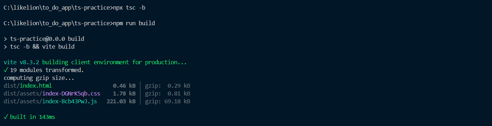
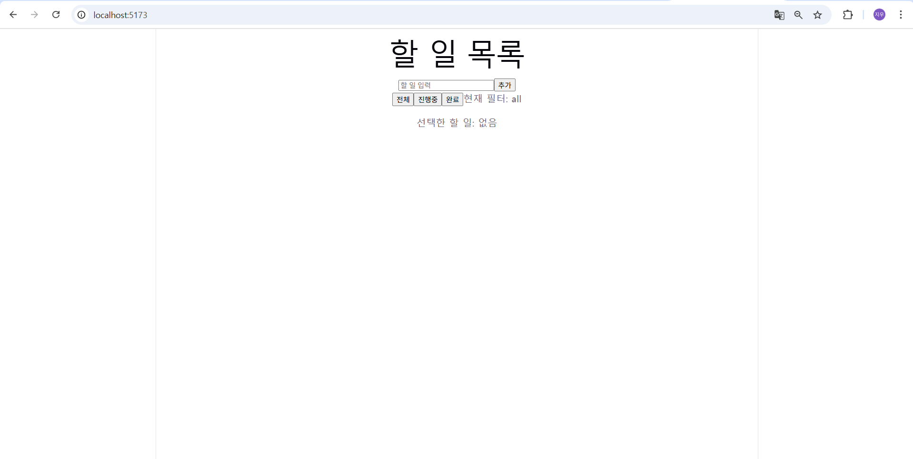

# 📝 To-Do App — JavaScript → TypeScript 전환

JavaScript로 작성된 To-Do 앱을 TypeScript 프로젝트로 옮기고 타입을 붙인 과제임.
새 기능 추가 없이 기존 코드 동작은 그대로 유지하고, 타입만 채워 넣음.

## 🛠 개발 환경

- Vite + React + TypeScript
- Linter: Oxlint

```bash
npm install
npm run dev     # 개발 서버 실행
npm run build   # 타입 검사(tsc -b) + 빌드
```

## 📁 파일 구조

```
src/
├── types.ts        # 여러 파일에서 공통으로 쓰는 타입
├── App.tsx         # 전체 상태 관리 (할 일 목록, 필터, 선택된 항목)
├── TodoInput.tsx   # 할 일 입력창 + 추가 버튼
├── TodoItem.tsx    # 할 일 한 줄 (체크박스, 텍스트, 삭제 버튼)
└── TodoFilter.tsx  # 전체 / 진행중 / 완료 필터 버튼
```

## 🧩 타입 설계

### 공통 타입 (`src/types.ts`)

2개 이상의 파일에서 쓰는 타입은 전부 `types.ts`에서 export함.

| 타입 | 형태 | 사용하는 파일 |
|---|---|---|
| `Todo` | `{ id: number; text: string; done: boolean }` | App, TodoItem |
| `Filter` | `"all" \| "active" \| "done"` (리터럴 유니온) | App, TodoFilter |

- `Filter`를 그냥 `string`이 아니라 리터럴 유니온으로 정의해서, 세 값 외의 오타(`"actve"` 등)가 들어오면 컴파일 단계에서 바로 에러가 남

### Props 타입

컴포넌트 props는 `interface`로 정의하고, 해당 컴포넌트 파일 안에 둠 (한 파일에서만 쓰기 때문).

- `TodoInputProps` — `onAdd: (text: string) => void`
- `TodoItemProps` — `todo`, `onToggle`, `onRemove`, `onSelect`
- `TodoFilterProps` — `filter`, `onChange: (filter: Filter) => void`

## 🔧 주요 해결 과정

`.jsx` → `.tsx`로 바꾸자 발생한 에러들과 해결 방법임.

### 1. `useState` 초기값 타입 추론 문제

| 기존 코드 | 문제 | 해결 |
|---|---|---|
| `useState([])` | `never[]`로 추론되어 할 일 추가 불가 | `useState<Todo[]>([])` |
| `useState(null)` | `null` 타입으로 고정되어 id 저장 불가 | `useState<number \| null>(null)` |
| `useState("all")` | `string`으로 추론되어 `Filter`와 불일치 | `useState<Filter>("all")` |

### 2. `selectedTodo`가 `undefined`일 수 있는 문제

```tsx
const selectedTodo = todos.find((todo) => todo.id === selectedId);
// find()의 반환 타입은 Todo | undefined
```

- 기존 JS 코드는 아무것도 선택하지 않은 상태에서 `selectedTodo.text`에 접근해 런타임 에러가 나는 버그가 있었음
- `!`(non-null assertion)로 강제로 넘기지 않고, 조건문으로 타입을 좁혀서 해결함

```tsx
<p>선택한 할 일: {selectedTodo ? selectedTodo.text : "없음"}</p>
```

### 3. 이벤트 객체 타입

```tsx
const handleChange = (e: ChangeEvent<HTMLInputElement>) => {
  setText(e.target.value);
};
```

### 4. 타입 import

Vite 템플릿에 `verbatimModuleSyntax`가 켜져 있어서, 타입만 가져올 때는 `import type`을 사용함.

```tsx
import type { Todo, Filter } from "./types";
```

## ✅ 필수 조건 체크

- [x] `npx tsc -b` 에러 0개
- [x] `any`, `as` 사용 0회
- [x] non-null assertion(`!`) 사용 0회 (템플릿의 `main.tsx` 제외)
- [x] `src/types.ts`에서 공통 타입 export
- [x] 컴포넌트 props 타입은 `interface`로 정의
- [x] 리터럴 유니온 사용 (`Filter`)

## 📸 실행 결과

### ① 타입 검사 통과 (`npm run build`)



### ② 동작 화면 (`npm run dev`)



할 일 2개 이상 추가 → 필터 버튼 클릭 → 할 일 클릭해서 "선택한 할 일" 표시된 상태

